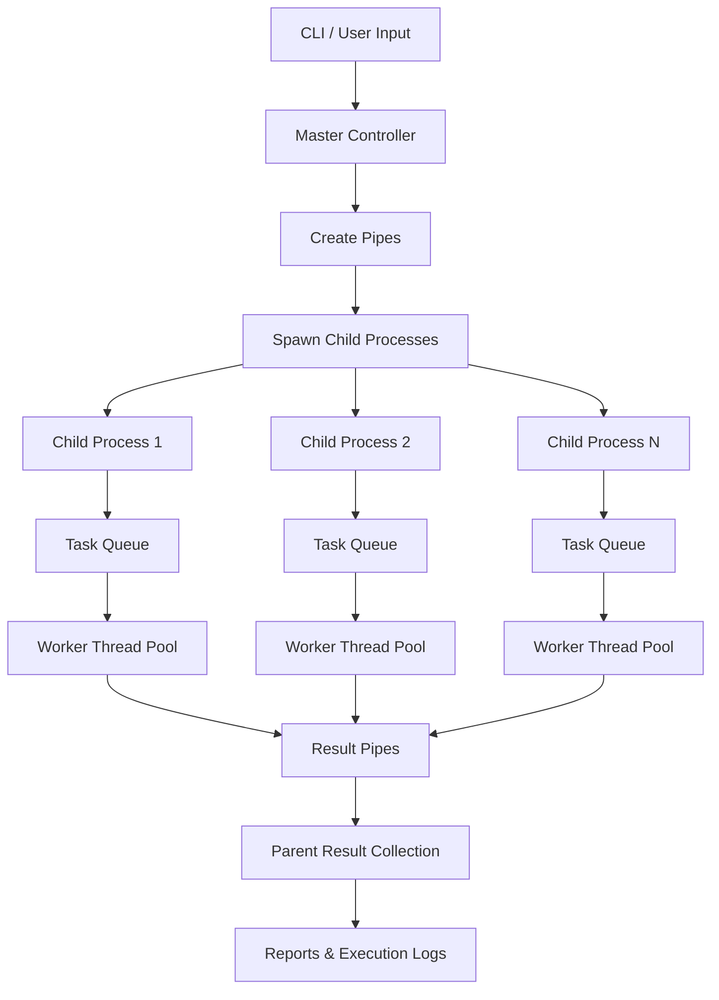

<div align="center">

# Parallel File Processing
## & Data Pipeline System

A Concurrent File Processing and Text Analysis Engine


</div>

---

## 📌 Project Overview

**Parallel File Processing & Data Pipeline System** is a Linux-based application developed in C to demonstrate the practical use of Operating Systems concepts.

The system is designed to process multiple text files concurrently using **process-level parallelism** and **multithreading**. It distributes file-processing tasks across child processes and worker threads to perform text analysis operations efficiently.

The project focuses on applying core OS concepts such as process management, Inter-Process Communication (IPC), thread synchronization, CPU scheduling, and memory management.

> **Project Status:** Currently under development as part of the CSE233 – Operating Systems course at Galala University.

---

## ✨ Key Features

- **Batch File Processing:** Process multiple text files from a target directory.
- **Text Analysis:** Count lines, words, and characters in input files.
- **Keyword Searching:** Search for specific words and patterns within files.
- **Multi-Process Architecture:** Distribute tasks across multiple child processes.
- **Multithreading:** Use POSIX threads to handle processing tasks concurrently.
- **Inter-Process Communication (IPC):** Exchange data between processes using UNIX pipes.
- **Thread Synchronization:** Coordinate worker threads using mutexes and condition variables.
- **Persistent Results:** Save processing results, reports, and execution statistics to output files.

---

## 🏗️ System Architecture

The system follows a **hierarchical multi-process and multi-threaded architecture**, combining two levels of parallelism:

### 1. Master Controller (Parent Process)
- Initializes the application and handles command-line inputs.
- Scans the target directory for input files.
- Creates communication pipes and spawns child processes using `fork()` and `execvp()`.
- Monitors child processes using `waitpid()`.

### 2. Process-Level Parallelism
- Creates multiple child processes to handle file-processing tasks.
- In Phase 1, one child process is assigned to each input file.
- Later phases introduce a configurable number of child processes.

### 3. Inter-Process Communication (IPC)
- Uses two UNIX pipes for each child process:
  - **Task Pipe:** Sends processing tasks from the parent to the child.
  - **Result Pipe:** Sends processed results and execution information back to the parent.
- Uses structured, length-prefixed messages for communication.

### 4. Thread-Level Parallelism
- Each child process maintains its own task queue.
- A pool of POSIX worker threads processes tasks concurrently.
- Uses FCFS (First-Come, First-Served) task scheduling.

### 5. Synchronization & Memory Management
- Uses `pthread_mutex_t` to protect shared resources.
- Uses `pthread_cond_t` to coordinate worker threads.
- Tracks dynamic memory allocation and deallocation using `malloc()` and `free()`.

### 6. Persistent Storage
- The parent controller collects results from child processes.
- Generates structured reports, processing summaries, and execution logs.

### Architecture Flow



---

## ⚙️ Operating Systems Concepts

This project demonstrates several fundamental Operating Systems concepts through practical implementation:

| OS Concept | Implementation | APIs / System Calls |
|---|---|---|
| Process Management | Creating and managing child processes | `fork()`, `execvp()`, `waitpid()` |
| System Calls | Executing programs and handling file operations | `open()`, `read()`, `write()`, `close()` |
| Inter-Process Communication (IPC) | Exchanging tasks and results between processes | `pipe()` |
| Multithreading | Creating and managing worker threads | `pthread_create()`, `pthread_join()` |
| Synchronization | Protecting shared resources and coordinating threads | `pthread_mutex_t`, `pthread_cond_t` |
| CPU Scheduling | Managing task execution order | FCFS |
| Memory Management | Dynamic memory allocation and tracking | `malloc()`, `free()` |
| File I/O & Storage | Reading input files and saving reports and logs | File I/O operations |

---
## 🗺️ Development Plan

The project follows a four-phase development plan aligned with the course project guidelines[cite: 5]:

### Phase 1: Processes & System Calls
- Set up the Master Controller to parse CLI inputs and scan the target input directory[cite: 2, 5].
- Spawn child processes using `fork()` and execute processing programs using `execvp()` (standard text tools such as `wc` and `grep` in Phase 1, and the custom worker binary in later phases)[cite: 2, 5].
- Monitor child processes and reap terminated processes using `waitpid()`[cite: 2, 5].

### Phase 2: IPC, Threads & Synchronization
- Establish UNIX pipe channels (`pipe()`) for each child: a **Task Pipe** (`parent → child`) and a **Result Pipe** (`child → parent`) using length-prefixed messages[cite: 2, 3, 5].
- Implement a mutex-protected Task Queue inside each child process[cite: 2, 5].
- Create a POSIX worker thread pool (at least 2 threads per child) using `pthread_create()` and `pthread_join()`[cite: 2, 4, 5].
- Synchronize access to shared queues and result buffers using `pthread_mutex_t` and `pthread_cond_t` to prevent race conditions and avoid busy-waiting[cite: 2, 4, 5].

### Phase 3: Scheduling, Memory & Storage
- Implement First-Come, First-Served (FCFS) task dispatching to worker threads[cite: 2, 5].
- Add custom memory tracking around `malloc()` and `free()` to monitor buffer allocations, deallocations, and potential leaks[cite: 2, 4, 5].
- Handle input file reading, result aggregation, and persistent output of structured reports and execution logs to disk[cite: 2, 4, 5].

### Phase 4: Integration & Performance Benchmarking
- Integrate all subsystems into a complete end-to-end pipeline for concurrent batch file processing[cite: 1, 5].
- Stress-test the system on multiple large text files and collect execution statistics[cite: 1, 5].
- Benchmark sequential vs. parallel execution across varying file counts, file sizes, child process counts, and worker thread counts, reporting wall-clock time and speedup ($\text{Sequential Time} / \text{Parallel Time}$)[cite: 5]. 
---
## 🎯 Expected Outcome

- **Concurrent Multi-File Processing:** A functional C application on Linux capable of distributing text-processing tasks across multiple child processes and POSIX worker threads concurrently[cite: 1, 5].
- **Structured Reporting & Logs:** Automated generation of structured analysis reports (line counts, word counts, character counts, and keyword matches) alongside detailed execution statistics and logs saved to disk[cite: 1, 2, 5].
- **Performance Validation:** Empirical benchmarking demonstrating measurable wall-clock speedup when comparing parallel execution against sequential file processing across varying workloads[cite: 5].

---
## 👥 Team Information

- **Course:** CSE233 – Operating Systems (Galala University, Faculty of Computer Science and Engineering)[cite: 1]
- **Instructor:** Dr. Amr Hefny[cite: 1]
- **Category:** Category 3 – Multi-threaded File Processor & Pipeline[cite: 1]
- **Group:** Group 6 (Lab Section: Wednesday 10:40 – J302)[cite: 1]

| # | Student Name | Academic ID |
|---|---|---|
| 1 | Ahmed Magdy *(Team Leader)* | 224107709[cite: 1] |
| 2 | Yomna Shaban Mawed Awis | 224126663[cite: 1] |
| 3 | Mohamed Mahmoud Elhelbawy | 224130166[cite: 1] |
| 4 | Mai Elsaid | 224126445[cite: 1] |
| 5 | Malak Motaz Mohamed | 224119578[cite: 1] |
| 6 | Menna Ayman Elshazly | 224116236[cite: 1] |
---
## 🚀 Getting Started (Build & Run)

### Prerequisites
- Linux environment (native Linux or WSL2)[cite: 1].
- GCC compiler with POSIX threads support (`gcc` and `-pthread`)[cite: 2, 4].
- Standard CLI text utilities (such as `wc` and `grep`) for Phase 1 testing[cite: 2, 5].

### Compilation Example
```bash
gcc -Wall -Wextra -pthread src/main.c src/worker.c -o pipeline_processor
### Usage Example
```bash
./pipeline_processor --dir ./input_files --keyword "error" --children 2 --threads 2
parallel-file-processor/
├── README.md
├── docs/
│   └── CSE233_Group6_ProjectProposal.pdf
├── src/
│   ├── master.c
│   ├── worker.c
│   ├── ipc.c
│   ├── mem_tracker.c
│   └── report.c
├── include/
│   └── pipeline.h
└── tests/
    └── sample_logs/